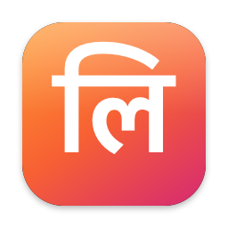

<p align="center"></p>

<h1 align="center">Lipi</h1>
<p align="center"><b>Speak Hindi. Type English.</b> Fast, private voice typing for Mac. Everything runs on your Mac.</p>

---

Lipi (लिपि, "script") is a menu-bar dictation app in the spirit of Wispr Flow, built for people who think and speak in Hindi or Hinglish but need to write in English. Hold a key, speak, let go: the text appears wherever your cursor is, already translated.

## Install

```bash
curl -fsSL https://raw.githubusercontent.com/the-real-sidd/lipi/main/install.sh | bash
```

Needs an Apple Silicon Mac on **macOS 26 or newer**. The app is about 1.5 MB. On first launch Lipi asks macOS to download the speech and translation languages you pick. macOS manages those files, shares them with other apps, and keeps them updated.

## What it does

| | |
|---|---|
| **Hold Right ⌥, speak** | Speak Hindi or Hinglish, and Lipi types English into any app |
| **Hold Right ⌥ + ⇧** | Type exactly what you said (Hinglish in Roman letters, or any language) |
| **Double-tap ⌥ on selected text** | Translate it: auto-detect, Hindi → English, English → Hindi, or any pair |
| **Notes** | Notices Zoom / Meet / Teams / FaceTime / Slack calls, offers to take notes, transcribes you ("Me") and the call ("Others"), summarises, and stops when the call ends |
| **Style** | Formal / Casual / very casual, chosen per app type: personal chats, work chat, email, other |
| **Dictionary** | Teach names, fix repeat mistakes, save snippets ("my email" → you@example.com) |
| **Voice commands** | "new line", "new paragraph", "scratch that" (also नई लाइन, हटा दो) |

Every language and key can be changed in **Settings**: the language you speak, the language you type in, the translate direction, both shortcuts, microphone and theme.

## How it's fast and small

Murmur, the app Lipi was modelled on, needs a 9 GB install (Ollama + two 4B LLMs + Whisper) and transcribes only after you stop talking. Lipi uses the models built into macOS and streams everything:

| | Murmur | Lipi |
|---|---|---|
| Install size | ~9 GB | **~1.5 MB** app + OS-managed language packs |
| Speech-to-text | Parakeet / Whisper, after you let go | Apple `SpeechAnalyzer`, **while you speak** |
| Translation | 4B LLM via Ollama | Apple `Translation`, kept warm while you speak |
| Cleanup | 4B LLM on every dictation | Instant rules; Apple Intelligence only for self-corrections |
| Extra apps | Ollama must be running | None |

Measured on an M1 with 8 GB, from releasing the key to text on screen:

| Dictation | Time |
|---|---|
| English | **~190–240 ms** |
| Hindi typed as spoken | **~350 ms** |
| Hindi → English | **~310–430 ms** |
| Translate selected text (warm) | **~60–90 ms** |

Tricks that make this possible:
- A speech analyzer is prepared ahead of time, so pressing the key only starts the audio.
- Models stay loaded for the life of the app.
- While you speak, Lipi translates the partial text in the background. macOS would otherwise unload the translation model after a few idle seconds (~400 ms cold vs ~70 ms warm).
- Romanized Hinglish is normalised before translation. The recognizer capitalises Hindi words at random, which the translator mistakes for names.
- Writing styles, fillers, stutters and commands are plain rules. They take under a millisecond and never need a model.

## Privacy

There's no account, no server and no analytics. Audio is never saved; only the text you choose to keep is stored:
- `~/Library/Application Support/Lipi/`: dictionary, history, meeting notes
- `~/Library/Logs/Lipi.log`: timings and lengths only, never what you said

## Build from source

```bash
git clone https://github.com/the-real-sidd/lipi && cd lipi
scripts/build.sh          # -> build/Lipi.app
scripts/build.sh --zip    # -> build/Lipi.zip for a release
```

Only the Xcode Command Line Tools are needed (Swift 6). The SwiftUI `@State` macro isn't available without full Xcode, so views use `@ViewState`, an alias for the same property wrapper.

Headless tools for testing and benchmarking:

```bash
L=build/Lipi.app/Contents/MacOS/Lipi
$L --status
$L --transcribe clip.aiff --locale hi-IN --to en --realtime   # full pipeline at speaking speed
$L --translate "kal office nahi aa paunga" --to en
$L --style "Hey, are you free?" --as veryCasual
$L --summarize transcript.txt
```

## Known limits

- **Not notarized.** Releases are signed with a self-made "Lipi Signing" certificate, not an Apple Developer ID. macOS therefore keeps Microphone and Accessibility permission across updates from 0.1.1 on, but the app isn't notarized. The installer uses `curl`, so Gatekeeper doesn't block it. Builds made on another Mac without that certificate are ad-hoc signed and ask for permissions again after each update.
- **Coming from 0.1.0?** Grant Accessibility once more after updating (use *Fix Accessibility* in Settings → Permissions if the switch already looks on).
- **Hindi comes out in Roman letters.** Apple's Hindi recognizer writes Hinglish in Roman letters (e.g. "mujhe lagta hai"), so "type as spoken" gives Hinglish, not Devanagari.
- **Smart cleanup needs Apple Intelligence.** It and AI meeting summaries only work when Apple Intelligence is on; otherwise Lipi uses its own rule-based cleanup and summary.
- **Call audio needs permission.** Capturing the other side of a call needs macOS's one-time *System Audio Recording* permission. Without it, notes capture your mic only.

## Layout

```
Sources/Lipi/
  AppDelegate.swift        hotkeys → record → pipeline → insert; meeting flow; menu bar
  SpeechEngine.swift       SpeechAnalyzer sessions, standby pre-warming, asset installs
  Audio.swift              mic capture + streaming resampler
  Pipeline.swift           cleanup → translate → smart cleanup → style → dictionary
  Translator.swift         Apple Translation sessions, batching, warm-up
  TextCleanup.swift        fillers, stutters, voice commands
  StyleEngine.swift        per-app style detection + formal/casual/very casual rules
  Hotkey.swift             modifier-key gestures (hold, +Shift, double-tap)
  Inserter.swift           paste with clipboard restore, read selection, cursor spacing
  Meetings/                detector (Core Audio), system-audio tap, recorder, summarizer, store
  UI/                      SwiftUI main window: Home, Notes, Style, Dictionary, Settings
```
